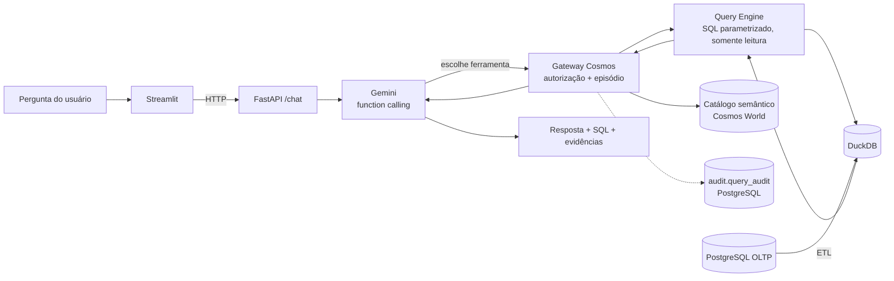

# Cosmos Semantic + Gemini: analytics conversacional governado

Prova de conceito em que uma pessoa pergunta em português sobre dados corporativos e recebe um número com o SQL executado, as regras de negócio e as evidências. O Gemini só orquestra ferramentas governadas por function calling. O Cosmos Semantic guarda o catálogo semântico, as capacidades, a proveniência e a autorização. Um Query Engine próprio monta SQL somente leitura sobre o DuckDB, e cada consulta fica em uma trilha de auditoria.

## A ideia da PoC

**O problema.** Perguntar "qual região teve a maior receita?" a um LLM costuma terminar em SQL inventado, números sem origem e nenhuma resposta para "quem autorizou isso?". Em dados corporativos, o mesmo termo ("faturamento") muda de significado entre áreas, e o modelo não deve ter acesso direto ao banco.

**A ideia.** Separar quem entende a pergunta de quem executa a consulta:

- O **Gemini** interpreta a pergunta e escolhe entre 7 ferramentas declaradas (`search_concepts`, `explain_metric`, `list_metrics`, `query_metric`, `list_dimensions`, `show_sql`, `get_evidence`). Não existe ferramenta de SQL livre.
- O **Cosmos Semantic** guarda atores, métricas, dimensões, glossário, regras e capacidades. Cada chamada de ferramenta passa por um gateway que registra a decisão de autorização, o episódio e o resultado.
- O **Query Engine** valida métrica, dimensões e filtros contra o catálogo e monta SQL parametrizado, executado em DuckDB aberto como somente leitura, com limite de linhas e timeout.
- A **auditoria** (`audit.query_audit`, no PostgreSQL) guarda pergunta, métrica, filtros, SQL, fonte, resultado e decisão do Cosmos.

**O que a PoC prova.**

- O Gemini real escolhe as ferramentas e preenche os argumentos usando só o catálogo governado, e responde em português com a métrica, o período e o `query_id`.
- Perguntas ambíguas ("faturamento") viram uma métrica definida, com a escolha explicada. Métricas inexistentes ("lucro") são recusadas, e dimensões não permitidas são rejeitadas.
- Cada número tem SQL, regras e fonte rastreáveis pelo `query_id`.
- Dados com defeitos propositais ficam isolados e nunca entram nas métricas oficiais.

**O que ela não pretende provar.** Autenticação real de usuários, desempenho em escala, multiusuário, fluxo de aprovação de conhecimento (`candidate` → `validated` → `active`) nem estabilidade total do LLM: respostas do Gemini variam entre execuções.

**O que o Cosmos é e não é aqui.** O Cosmos **não é uma camada semântica SQL** e não executa consultas analíticas. Aqui ele é o registro de conhecimento (World), o validador do grafo (`cosmos validate`) e o gateway de autorização e episódios das chamadas de ferramenta. A tradução de métrica em SQL é do Query Engine, escrito neste repositório. O Cosmos está em Developer Preview e fica fixado em um commit (`464175f`). Detalhes em [`docs/ARCHITECTURE.md`](docs/ARCHITECTURE.md) e [`cosmos/documentation/USO_DO_COSMOS.md`](cosmos/documentation/USO_DO_COSMOS.md).

## Arquitetura



Fluxo: pergunta → function calling do Gemini → gateway do Cosmos → Query Engine → DuckDB → resposta com evidência.

## Stack

| Camada | Tecnologia |
|---|---|
| OLTP | PostgreSQL 16, 8 tabelas com PK, FK e constraints; dados sintéticos Faker pt_BR (seed 42) |
| Analytics | DuckDB: 4 dimensões e 4 fatos carregados por ETL |
| Semântica | YAML em `semantic/` sincronizado com o Cosmos |
| LLM | Google Gemini (`google-genai`), padrão `gemini-2.5-flash` |
| API | FastAPI |
| Interface | Streamlit (5 páginas) |
| Execução | Docker Compose ou Python 3.11 local |

Volumes (seed 42, 24 meses até 2026-10-31): 5.000 clientes, 500 produtos, 20.000 pedidos, 47.617 itens, 20.000 pagamentos e 7.194 reembolsos.

## Estrutura do projeto

```
app/{api,frontend,services}     API FastAPI, páginas Streamlit, Query Engine e auditoria
agent/{gemini,tools,orchestration}  Gemini, as 7 ferramentas e o gateway Cosmos
semantic/{metrics,dimensions,rules,glossary}  catálogo em YAML e sync com o Cosmos
data/generators                 gerador de dados sintéticos e laboratório de defeitos
database/                       migrações e papéis do PostgreSQL
pipelines/{extract,transform,quality}  ETL e regras de qualidade
tests/{unit,integration,security,frontend,golden,live}
docs/ARCHITECTURE.md            decisões e capacidades do Cosmos
docs/history/                   relatórios de fases e de aceite
Dockerfile  docker-compose.yml  Makefile  .env.example  LICENSE
```

## Início rápido com Docker Compose

Requisitos: Docker Desktop, ou colima com o CLI `docker` e o plugin `compose`, e uma chave do [Google AI Studio](https://aistudio.google.com/).

```bash
git clone <url-deste-repositorio> && cd poc-cosmos
cp .env.example .env              # edite: GEMINI_API_KEY e as senhas "troque-me-*"
docker compose up -d postgres
docker compose run --rm init      # World do Cosmos, migração, carga, ETL, qualidade e sync
docker compose up -d api frontend
docker compose ps                 # os três serviços devem aparecer como healthy
```

- Interface: <http://127.0.0.1:8501>
- API e documentação interativa: <http://127.0.0.1:8000> e <http://127.0.0.1:8000/docs>

Sem `GEMINI_API_KEY`, a API sobe e `POST /chat` responde 503 `gemini_not_configured`. O resto funciona. Para parar: `docker compose down` (acrescente `-v` para apagar os volumes).

## Execução local, sem Docker

Requisitos: macOS ou Linux, Python 3.11+, `git`, `uv` (`pip install --user uv`) e acesso à internet para a instalação.

```bash
cp .env.example .env
bash scripts/bootstrap.sh     # venv, dependências, Cosmos no commit fixado e World
make data                     # pg-start, migrate, load, etl e quality
make sync                     # YAML semântico -> Cosmos + cosmos validate
make metric-tests             # as 8 métricas contra SQL de referência
.venv/bin/uvicorn app.api.main:app --port 8000
API_URL=http://localhost:8000 .venv/bin/streamlit run app/frontend/Home.py --server.port 8501
```

O PostgreSQL local vem do pacote `pgserver` (porta 54329, dados em `pgdata/`). `make pg-stop` o encerra. `SEED=7 make load` troca a seed (os testes golden assumem a 42).

Configuração no `.env` (carregado pelo `Makefile`):

| Variável | Padrão | Uso |
|---|---|---|
| `GEMINI_API_KEY` | vazio | Chave do Google AI Studio. Nunca vai para o git nem para os logs |
| `GEMINI_MODEL` | `gemini-2.5-flash` | Modelo Gemini (validado contra a API real) |
| `PG_*` | ver `.env.example` | Conexão e senhas dos papéis do PostgreSQL |
| `SEED`, `DATA_END_DATE` | `42`, `2026-10-31` | Geração determinística |
| `API_URL` | `http://localhost:8000` | API usada pelo Streamlit |

### Testes

```bash
make test                                                   # suíte padrão, sem Gemini ao vivo
.venv/bin/python -m pytest -m live_gemini -q                # 14 perguntas com o Gemini real (exige GEMINI_API_KEY e cota)
```

A suíte sobe um PostgreSQL temporário próprio. Os testes `live_gemini` ficam em skip sem a chave.

## Exemplos de uso

Os resultados abaixo foram obtidos contra a stack em execução (seed 42, dados até 2026-10-31).

### Endpoints

| Método e rota | Descrição |
|---|---|
| `GET /health` | Estado de PostgreSQL, DuckDB, Cosmos e Gemini |
| `POST /chat` (alias `/ask`) | Pergunta em linguagem natural. Corpo: `{"question": "..."}` |
| `POST /tools/{nome}` | Chama uma das 7 ferramentas diretamente, sem o Gemini |
| `GET /evidence/{query_id}` | Evidência de uma consulta |
| `GET /catalog/metrics`, `/catalog/dimensions`, `/catalog/glossary` | Catálogo semântico |
| `GET /quality/runs`, `/quality/results`, `/etl/runs` | Qualidade e ETL |
| `GET /audit/queries`, `/audit/queries/{query_id}` | Trilha de auditoria |
| `GET /overview` | KPIs da Visão Geral |

### Chat

O corpo aceita apenas `question`. Campos extras, como `user`, são rejeitados (`extra="forbid"`).

```bash
curl -s -X POST http://127.0.0.1:8000/chat \
  -H 'content-type: application/json' \
  -d '{"question": "Qual região teve a maior receita?"}'
```

A resposta é um JSON com `status`, `answer`, `model`, `tool_calls`, `queries` (SQL, linhas e `query_id`), `cosmos_episode_id` e `request_id`. O campo `answer` veio assim:

> A região que teve a maior receita foi o Sudeste, com R$ 13.063.627,23. Para esta consulta, utilizei a métrica `net_revenue` (Receita Líquida)...

### Ferramentas e catálogo, sem Gemini

```bash
curl -s -X POST http://127.0.0.1:8000/tools/query_metric \
  -H 'content-type: application/json' \
  -d '{"metric":"net_revenue","dimensions":["region"],"order_by":{"field":"metric","direction":"desc"},"limit":2}'
# rows: Sudeste 13063627.23, Nordeste 5091038.54

curl -s http://127.0.0.1:8000/catalog/metrics
curl -s http://127.0.0.1:8000/catalog/dimensions
curl -s http://127.0.0.1:8000/health
```

### Perguntas de exemplo e respostas verificadas

| Pergunta | Resposta obtida |
|---|---|
| Qual região teve a maior receita? | Sudeste, R$ 13.063.627,23 (`net_revenue`) |
| Qual foi o faturamento dos últimos 30 dias? | R$ 876.344,70, de 2026-10-02 a 2026-10-31 (o assistente escolheu `net_revenue` e explicou a escolha) |
| Quantos clientes ativos temos? | 1.424 (`active_customers`, últimos 90 dias até 2026-10-31) |
| Qual categoria possui o maior ticket médio? | Games, R$ 2.516,92 |
| Qual foi o lucro do último mês? | Recusa: a métrica "lucro" não existe; sugere `net_revenue` e `gross_revenue` |

Outras perguntas do roteiro: "Compare o faturamento dos últimos dois meses", "Qual é a taxa de cancelamento?", "Explique como o faturamento líquido é calculado", "Quantos clientes ativos por categoria?" (dimensão não permitida, só região e segmento). As 19 perguntas com resultado esperado calculado por SQL independente estão em `tests/golden/questions.json` e `tests/golden/expected.json` (`make golden` recalcula). O texto exato do Gemini varia a cada chamada. Os números não.

## Tour pelas páginas do Streamlit

1. **Analytics Assistant**: caixa de chat. Cada resposta traz expansores com o SQL executado e as evidências. Há também a aba "Consulta direta de métrica", que funciona sem chave.
2. **Semantic Catalog**: métricas, dimensões e glossário com fórmula, denominador, regra de status, base de tempo, dono e versão.
3. **Data Quality**: execuções e resultados das regras de qualidade e da reconciliação PostgreSQL × DuckDB, incluindo o laboratório de defeitos.
4. **SQL and Evidence**: dado um `query_id`, mostra o SQL, os filtros aplicados, a fonte e a decisão de autorização.
5. **Data Overview**: KPIs e gráficos por dimensão, calculados pelas mesmas métricas governadas.

## As 8 métricas

| Métrica | Nome | Definição resumida |
|---|---|---|
| `gross_revenue` | Receita Bruta | Soma dos itens de pedidos `paid` e `refunded`, antes de reembolsos |
| `net_revenue` | Receita Líquida | Receita bruta menos reembolsos `completed` |
| `refund_amount` | Valor de Reembolsos | Soma dos reembolsos `completed`, pela data do pedido de origem |
| `order_count` | Quantidade de Pedidos | Pedidos de qualquer status |
| `average_order_value` | Ticket Médio | Receita líquida dividida pelos pedidos pagos |
| `cancellation_rate` | Taxa de Cancelamento | Pedidos `cancelled` sobre todos os pedidos (razão de 0 a 1) |
| `active_customers` | Clientes Ativos | Clientes distintos com pedido pago nos últimos 90 dias |
| `monthly_revenue_growth` | Crescimento Mensal da Receita | Receita líquida do mês sobre a do mês anterior, menos 1 |

Dimensões disponíveis: veja `GET /catalog/dimensions` (por exemplo `region`, `category`, `date`, `month`). Cada métrica aceita só as dimensões listadas no catálogo.

## Governança e segurança

- O Gemini não escreve SQL nem acessa banco. `POST /tools/execute_sql` devolve 404.
- Argumentos validados no backend. SQL parametrizado e montado só pelo Query Engine, executado em DuckDB `read_only`, com limite de linhas e timeout.
- Papéis separados no PostgreSQL (admin, loader, reader, dq, app) com permissão mínima. O papel da aplicação não altera a auditoria.
- Auditoria em `audit.query_audit`, com a decisão de autorização do Cosmos.
- Segredos só por variáveis de ambiente. Os logs redigem a chave e as senhas.
- **A chave do Gemini nunca é commitada.** `.env`, `.venv`, `.vendor`, `pgdata/`, bancos DuckDB e logs estão no `.gitignore`. O `.env.example` só traz placeholders.
- Sem autenticação de usuários: o usuário vem do cabeçalho `X-User-Id` (padrão `demo`), sem verificação de identidade. Adequado só a uma PoC.

## Laboratório de qualidade de dados

Os defeitos propositais ficam em `dq_lab.duckdb` e no esquema `dq_lab` do PostgreSQL, isolados dos dados oficiais. Sete regras os detectam: pedido cancelado com pagamento capturado, pagamentos duplicados, datas inconsistentes, itens sem produto, valores negativos, pedidos sem cliente e reembolso maior que o pago. Na última execução, o banco oficial teve 0 violações em todas as regras e a reconciliação PostgreSQL × DuckDB bateu. O laboratório teve 4, 5, 7, 6, 6, 7 e 3 violações, respectivamente, e fez divergirem `gross_revenue`, `net_revenue` e `average_order_value`. Nada disso aparece na Visão Geral. Veja a página **Data Quality** ou `GET /quality/results`. Para repetir: `make quality`.

## Limitações e estado da verificação

Verificado por execução:

- Suíte padrão: 271 testes passam (`make test`).
- **Docker Compose, de ponta a ponta:** `postgres`, `init`, `api` e `frontend` subiram, os três serviços de longa duração ficam `healthy`, e `/chat` respondeu Sudeste, R$ 13.063.627,23.
- **Gemini real** (`gemini-2.5-flash`): 12 das 14 perguntas golden passaram na última rodada. As duas falhas (q15, q17) são de interpretação, não de API: ver abaixo.
- Execução local sem Docker, ETL, qualidade e as 8 métricas contra SQL de referência.

Não verificado ou com ressalvas:

- **`live_gemini` não é determinístico.** Em q15 ("Como cresceu a receita líquida no Sudeste...") o modelo consultou `net_revenue` por mês e calculou o crescimento sozinho, em vez de chamar `monthly_revenue_growth`. Os valores mensais da resposta estavam corretos (R$ 639.927,52 e R$ 475.964,53), mas o teste exige o valor da métrica de crescimento. Os testes não foram afrouxados.
- A interface Streamlit foi testada por AppTest e HTTP 200, mas não foi inspecionada em navegador.
- Instalação local em clone limpo (`bootstrap.sh` do zero) não foi exercitada.
- O 504 `query_timeout` da API não tem teste próprio. Desempenho sob carga não foi medido.
- O sync grava conhecimento já `active`, sem fluxo de aprovação.
- Validado em macOS arm64. `pgserver` é só para desenvolvimento local.

Relatórios completos: [`docs/history/ACCEPTANCE_REPORT.md`](docs/history/ACCEPTANCE_REPORT.md) e [`docs/history/PHASE_REPORTS.md`](docs/history/PHASE_REPORTS.md).

## Licença

[MIT](LICENSE), copyright 2026 edipo-dados.
